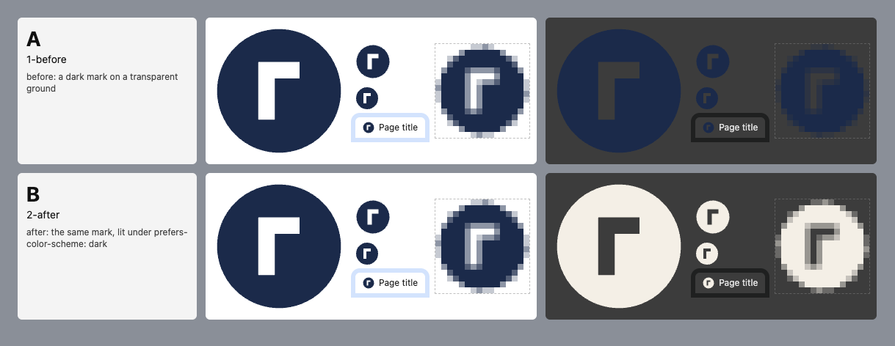

# tabcheck

**Does your favicon actually show up on a browser tab?**

Most icon tools resize your SVG and stop there. tabcheck renders it in real Chromium, the
rasteriser a tab strip uses, on light and dark tabs, measures the pixels, and fails CI when the
mark disappears. Then it exports the whole icon set from the same master: all of it or nothing.



```
$ npx tabcheck check icon.svg
FAIL  icon.svg
  · [safe-zone] ink reaches 241 px from centre at 512; maskable: draw the mark at most 421 px, centred (export does this for you)
  · [contrast] light #ffffff: 100% of the mark at >= 3:1 (median 14.22:1, need 75%)
  · [contrast] light (inactive tab) #dee1e6: 100% of the mark at >= 3:1 (median 10.85:1, need 75%)
  ✗ [contrast] dark #202124: 0% of the mark at >= 3:1 (median 1.13:1, need 75%)
  ! [contrast] dark (inactive tab) #35363a: 0% of the mark at >= 3:1 (median 1.18:1, need 75%)
```

## Quick start

Needs Node 22+ and a Chromium (your installed Chrome works; see [Browser](#browser)).

```sh
npx tabcheck check icon.svg                      # gates; exit 1 if any fail
npx tabcheck sheet concepts/ --out sheet.png     # compare designs at every size, light and dark
npx tabcheck export icon.svg --plate '#0f1626' --out public/   # the whole set, or nothing
```

In CI, `npx tabcheck check` in any job with Chromium is enough: the exit code is the gate.

## `check`: the gates

| Gate | Fails when |
| --- | --- |
| `xml` | the browser's own XML parser rejects the file. The classic: `--` inside a comment, which is illegal XML and renders a **blank** favicon |
| `no-text` | `<text>`: live text depends on fonts the viewer may not have. Convert it to outlines |
| `no-foreign`, `no-raster`, `no-external` | `<foreignObject>`, `<image>`, or an `http(s)` reference: none of them render in a favicon |
| `viewbox` | no `viewBox`, or not square |
| `blank` | under 1 % of a 512 px render is painted |
| `contrast` | under **75 %** of the mark's opaque pixels reach **3:1** against the active tab, light and dark, measured at 32 px. The inactive tab only warns |
| `safe-zone` (info) | never fails: reports the size at which the mark fits a maskable icon's central 80 % circle, measured from the render, not the `viewBox` |
| `bbox` (warn) | the ink spans under 60 % of the canvas, so it will be tiny at 16 px |

Light tabs are rendered under `prefers-color-scheme: light` and dark tabs under `dark`, as a browser
does, so a mark that switches colour in a `<style>` media query is judged by what users actually see.
That is usually the fix: one colour rarely clears 3:1 on both a white and a near-black tab.

`--plate '#0f1626'` (or `'#a,#b'` for a gradient) also gates the ground of your installed icons.
Colours are any CSS colour (`rgb(15, 22, 38)` counts as one), and a colour the browser does not
recognise is an error rather than a silent black.
`--json` prints the full report.

### The tab colours

| | Active tab (gated) | Inactive strip (warns) |
| --- | --- | --- |
| Light | `#ffffff` | `#dee1e6` |
| Dark | `#202124` | `#35363a` |

These are Chrome's default-theme tab colours. Chrome derives them from the user's theme, so treat
them as a sensible default rather than the only truth, and override them with `--light '#a,#b'`
and `--dark '#a,#b'`.

## `sheet`: compare designs

One row per SVG: 180, 48 and 32 px, the 16 px favicon in a mock tab, and that 16 px render blown
up ×8, which is the only honest view of a favicon. Light and dark side by side. `--plate` adds the
installed icon as an iOS rounded square and an Android circle mask, placed as `export` writes
them at its defaults (`--fill 0.72`, `--scheme auto`). Every raster is also written
to `sheet/<name>/<scheme>-<size>.png` unless `--no-pngs`.

A `name.favicon.svg` beside `name.svg` is that design's hand-drawn 16 px master; the sheet uses it
for the 16 px cells.

## `export`: the whole set, or nothing

```sh
npx tabcheck export icon.svg --plate '#0f1626' --out public/ [--favicon icon.favicon.svg]
```

| File | What |
| --- | --- |
| `favicon.svg` | the master as drawn: transparent and scheme-aware |
| `favicon.ico` | 16 + 32 + 48, transparent, light-scheme variant (an `.ico` cannot switch) |
| `apple-touch-icon.png` | 180, full bleed on the plate (iOS fills transparency with black) |
| `icon-192.png`, `icon-512.png` | `purpose: any`, on the plate |
| `icon-maskable-512.png` | scaled so the furthest ink sits inside the central 80 % circle |
| `manifest-icons.json` | the manifest `icons` array for the above |

`export` re-runs `check` with the plate gated, renders everything in memory, refuses any raster
under 1 KB (placeholder size: a 1×1 PNG, a `data:,` favicon), writes the set to a staging folder
beside `--out`, and only then moves it in. Installed
icons render in the plate's scheme: on a dark plate, the mark's dark-scheme variant.

## Browser

tabcheck does not download a browser on install. It looks, in order, for:

1. `--browser <path>` or `TABCHECK_BROWSER`
2. your installed Google Chrome
3. Playwright's Chromium: `npx playwright-core install chromium-headless-shell`

The SVG under test is treated as untrusted: it is only ever drawn as an image, so its scripts
never run, and the page refuses every network request. Both are covered by tests.

## Exit codes

`0` every file passed · `1` a gate failed (and `export` wrote nothing) · `2` usage or environment
error (no browser, unreadable file, bad flag or colour) · `3` tabcheck itself crashed: please
[report it](https://github.com/brandtstack/tabcheck/issues).

## Programmatic use

```ts
import { withPage, checkSvg, DEFAULTS } from 'tabcheck';

const report = await withPage((page) => checkSvg(page, 'icon.svg', svgText, DEFAULTS));
```

---

Built for [brandtstack.com](https://brandtstack.com). MIT licence.
